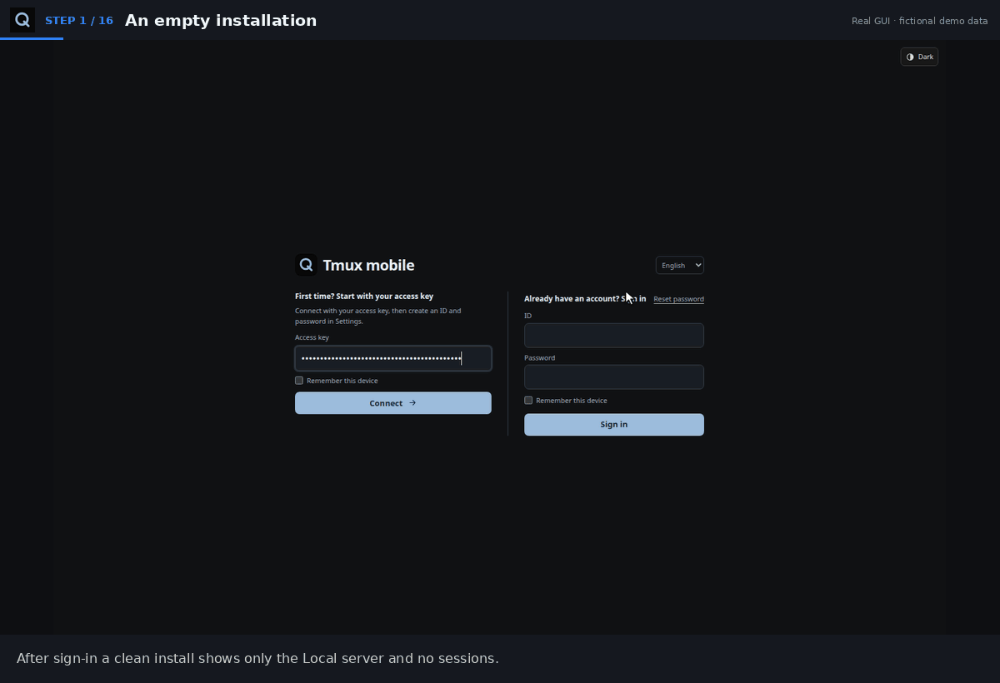
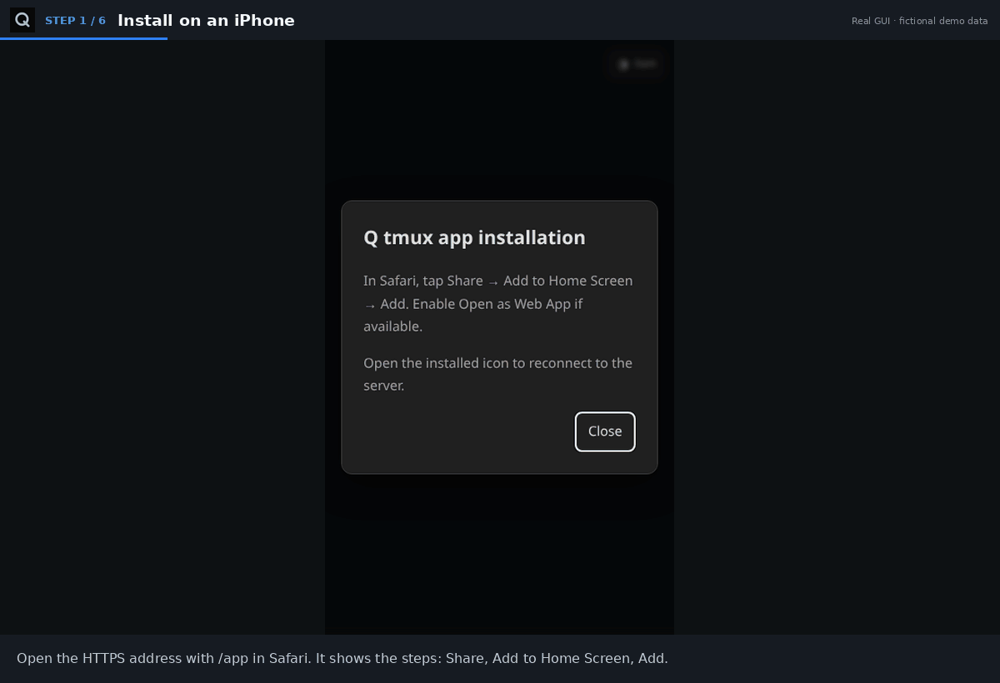

# tmux mobile

Use the tmux sessions on your server from your phone or any browser.

- See what Claude Code or Codex is doing in a session and reply to it.
- Type into the real terminal when you need to.
- Browse, edit and upload files on the server. Word, Hangul and PowerPoint files open right in the browser.
- Keep several sessions side by side, from one or more servers.

It runs on your own server. The phone only needs a browser.



[Every feature in order](docs/demos/all-features.gif) · [Step-by-step walkthrough](docs/gui-guide.md)

## Install

### Option 1: let your coding agent do it

1. On the server, open Claude Code, Codex or another coding agent.
2. Give it [AGENT_SETUP.md](AGENT_SETUP.md) (attach the file or paste its text) and say:

   ```text
   Set up tmux mobile on this machine by following this file.
   ```

3. When the agent is done, run `tmux-mobile url` on the server and open that link on your phone.

The agent installs anything that's missing. If sudo needs your password, it asks you to type it yourself; without sudo, everything goes into your home folder.

### Option 2: do it yourself

**Step 1. Install the tools.** You need Linux with Python 3.11+, tmux, Node.js, git and curl. Pick one:

*If you can use sudo* (Ubuntu 24.04+, Debian 12+):

```bash
sudo apt-get update
sudo apt-get install -y git tmux python3 python3-venv python3-pip nodejs npm curl
```

*If you can't use sudo*, install them into your home folder with [micromamba](https://mamba.readthedocs.io/en/latest/installation/micromamba-installation.html). If tmux is already installed on the machine, remove `tmux` from the list.

```bash
mkdir -p ~/.local/bin
curl -Ls https://micro.mamba.pm/api/micromamba/linux-64/latest | tar -xj -C ~/.local bin/micromamba
~/.local/bin/micromamba create -y -p ~/.local/tmux-mobile-env -c conda-forge python=3.12 tmux nodejs git curl
echo 'export PATH="$HOME/.local/tmux-mobile-env/bin:$HOME/.local/bin:$PATH"' >> ~/.bashrc
source ~/.bashrc
```

**Step 2. Install and start tmux mobile.**

```bash
git clone https://github.com/q-mini/tmux-mobile.git
cd tmux-mobile
python3 scripts/bootstrap.py
tmux-mobile start
```

**Step 3. Open it on your phone.** `tmux-mobile start` prints something like this:

```text
Started tmux-mobile with a public HTTPS address.
Session  tmux attach -t tmux-mobile
Local    http://127.0.0.1:8765
Phone    https://<random-name>.trycloudflare.com
Key      <access key>
Open     https://<random-name>.trycloudflare.com/#key=<access key>
```

Open the `Open` link on your phone. You're signed in, and the key disappears from the address bar.

**Step 4 (optional). Add it to your home screen or desktop.** Open the `Phone` address with `/app` at the end (`https://<random-name>.trycloudflare.com/app`). It shows the install steps for your browser: Share → Add to Home Screen on iPhone, ⋮ → Add to Home screen on Android, and the address-bar install icon in Chrome or Edge on a computer. The [walkthrough](docs/gui-guide.md#add-it-to-a-phone-home-screen-or-the-desktop) shows each one.



### Good to know

- The phone address comes from a free Cloudflare tunnel and changes every time the tunnel restarts. Run `tmux-mobile url` again to get the new link.
- Want it on this computer only, with no phone address? Use `python3 scripts/bootstrap.py --local` and `tmux-mobile start --local`.
- Treat the key like a password: anyone with the link can use your terminal.
- `bootstrap.py` keeps everything inside the `tmux-mobile` folder, except the `tmux-mobile` command, which it links into `~/.local/bin`.

| Command | Does |
|---|---|
| `tmux-mobile start [--local] [--session NAME]` | Start if needed, then print the addresses and key |
| `tmux-mobile status` | Print the addresses and key of the running server |
| `tmux-mobile url` | Print only the sign-in link |
| `tmux-mobile key` | Print only the key (also in `.state/access-key`) |
| `tmux-mobile stop` | Stop the server and tunnel; other tmux sessions stay |

The app opens in English. Switch to Korean on the sign-in screen or in Settings; the browser remembers your choice.

## Follow the GUI, one feature at a time

Each section of the [walkthrough](docs/gui-guide.md) lists the steps, then shows them in a short clip.

| Start here | What the walkthrough covers |
|---|---|
| [Home screen and desktop install](docs/gui-guide.md#add-it-to-a-phone-home-screen-or-the-desktop) | `/app` install steps for iPhone, Android and Chrome/Edge, then opening the installed icon |
| [First sign-in and new session](docs/gui-guide.md#2-create-a-new-tmux-session) | Empty state, initial key, server/name/start directory, opening a shell |
| [Session management](docs/gui-guide.md#3-find-switch-and-manage-sessions) | Switching, search, drafts, rename, session deletion versus closing a view |
| [Folders](docs/gui-guide.md#4-organize-sessions-into-folders) | Subfolders, drag/hold to move, shared organization, outside-click menus |
| [Reader / Terminal](docs/gui-guide.md#5-read-output-or-use-the-original-terminal) | Live tmux, conversation/code/tables, fullscreen and sizing |
| [Input](docs/gui-guide.md#6-compose-messages-and-use-the-keyboard) | Send/newline, IME, immediate keyboard keys and saved drafts |
| [Split workspaces](docs/gui-guide.md#7-split-workspaces-side-by-side-or-topbottom) | Split menu or drag a session onto an edge, phone halves, divider resizing |
| [Detach / Return](docs/gui-guide.md#8-detach-and-return-a-workspace) | Separate windows, popup permission, returning to the workspace |
| [Files](docs/gui-guide.md#11-browse-and-preview-server-files) | Tree, search, code/images/documents, editing, download and file-window splits |
| [Office and Hangul documents](docs/gui-guide.md#office-and-hangul-documents) | `.docx`, `.hwp`/`.hwpx` as white pages, `.xlsx` sheets and `.pptx` slides without Office installed |
| [Uploads / Trash](docs/gui-guide.md#13-upload-files-into-a-chosen-folder) | Folder destinations, drops, choosing the Trash folder, seven-day restore |
| [Chat images](docs/gui-guide.md#15-attach-files-to-a-message-and-inspect-images) | Temporary attachments, fit/actual size, compact Back/Close controls |
| [Notifications](docs/gui-guide.md#16-notifications) | Opaque inbox/banner, eight-second auto-hide, × and upward swipe |
| [Settings / servers](docs/gui-guide.md#17-language-theme-and-accounts) | Remembered language, themes, accounts/devices and authenticated SSH setup |

## Working on the app

`make run` runs the server in the foreground of the current terminal instead of a tmux session, which is useful when you want to watch its output or a traceback. `make screenshots` re-records the guide clips.

```text
backend/       HTTP API, tmux, SSH, files and accounts
web/           Web UI and locally served assets
scripts/       Install, start/stop, and record the guide clips
docs/          Walkthrough and its clips
skills/        Reusable agent setup/operation skill
```

Runtime state, logs, keys, account databases, real SSH configuration, conversations, attachments and installed dependencies are excluded from Git. Third-party terminal/font licenses remain beside their assets.
