# GUI walkthrough

This guide goes from an empty install to several servers, split windows and files. Each section gives the steps, then a short clip of them.

The clips were recorded from the real app on a throwaway tmux server with made-up data. Agent replies, models, skills and notifications are fixtures; no SSH login or LLM call happens. Long waits are fast-forwarded and marked in the clip.

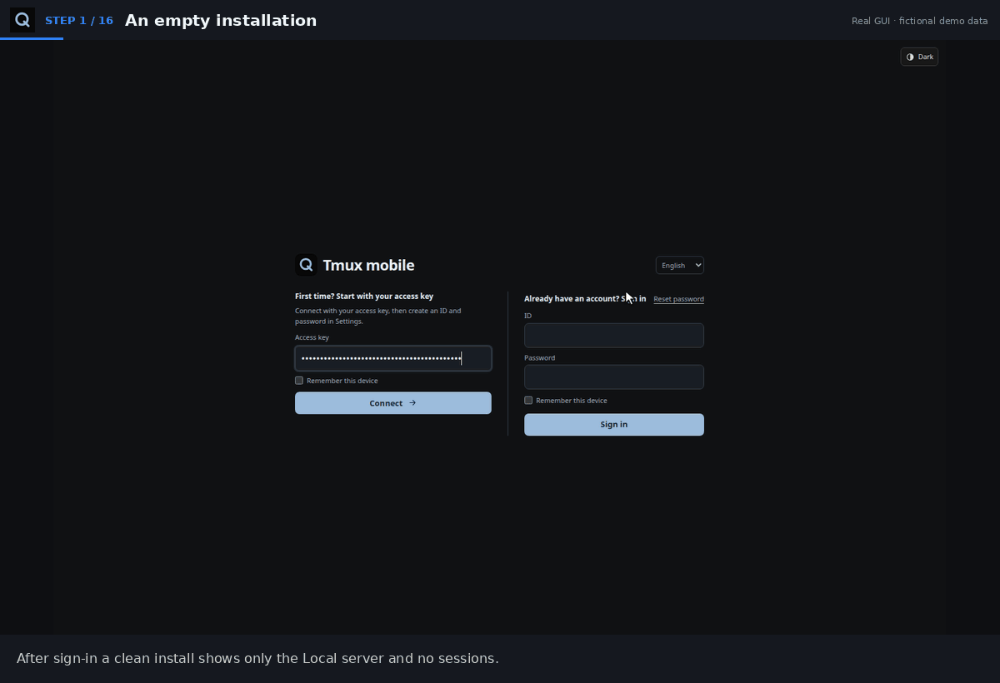

**English is the default for a new browser.** Choose Korean in the login screen or Settings to keep Korean on subsequent visits in that browser. Switching language does not translate your messages, file names or source code.

## 1. Install and open the app

Complete [AGENT_SETUP.md](../AGENT_SETUP.md), or follow the [README](../README.md). Open the local address recorded in `.state/listen-url`. For phone access, start the HTTPS tunnel and use `.state/public-url`.

The initial key is generated in this installation’s private `.state/access-key`. Enter it in **Access key**. Existing account holders can use the ID/password form instead. **Remember sign-in on this device** is optional; a new browser must authenticate separately.

An empty session list is normal. A clean installation starts with **Local** only; it does not import another person’s servers, sessions or accounts.

The [complete recording](demos/all-features.gif) plays every scene in this guide in order. The animations below each cover one section.

## 2. Create a new tmux session

1. Click **New session ＋** at the bottom of the left sidebar. From the session manager, use its new-session button.
2. Choose the server. Initially, only Local is available. Connect another server before choosing it here.
3. Enter a session name: letters, digits, hyphens or underscores, starting with a letter/digit; up to 60 characters.
4. Optionally enter an existing absolute starting directory **on that server**. Leave it empty to use the server’s default directory.
5. Submit the form. The app creates a new shell and opens its terminal; it does not replace an existing session.

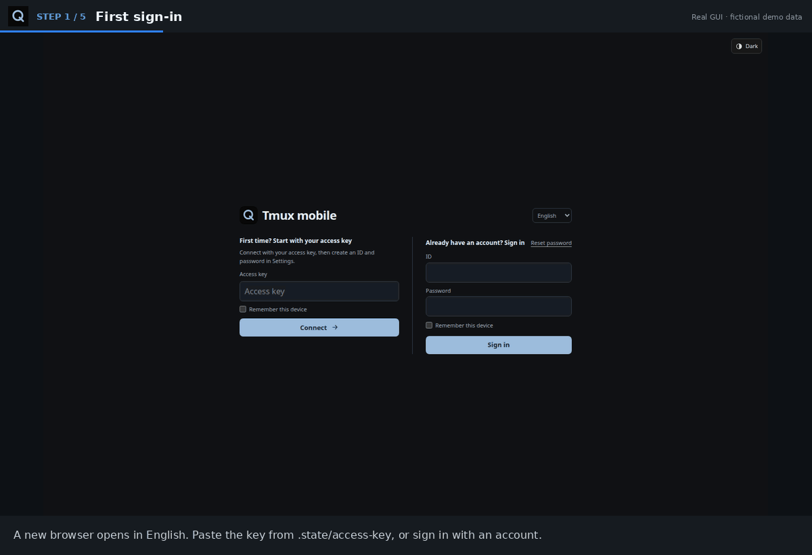


Start your installed Codex, Claude or other command-line tool in that shell. Installing this web app does not install or log in to an AI provider. The documentation terminal below is a sandbox receiver.


## 3. Find, switch and manage sessions

- The left sidebar groups sessions by server. Click a session to open it in the active workspace. The selected session is highlighted.
- Switching preserves each pane’s draft, the selected pane, Reader/Terminal view and embedded/fullscreen mode. Clicking the current session keeps its draft and scroll position.
- Use the session manager’s search to find a session by name, directory or running program. Per-server status distinguishes authenticated access from a server that still needs setup.
- Use a session’s **⋯ → Rename** to edit its name inline; Enter confirms and Escape cancels.
- A session’s delete action affects the actual tmux session and its running work. A workspace’s **×** closes only that web view.

## 4. Organize sessions into folders

1. Click the server’s **⋯ → Create folder** and name the folder.
2. Click that folder’s **⋯ → Create subfolder** to build a hierarchy.
3. Drag a session onto a folder. On a phone, hold the session before dragging. Indentation and connector lines show where it belongs.
4. Click a folder’s arrow to collapse or expand its contents. Rename/reposition it from its own menu.

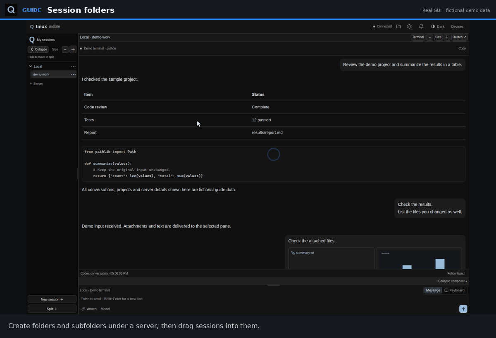


These are navigation folders, not disk directories. Deleting one moves its children/sessions to its parent; it does not delete code or files. Organization is shared with other authenticated devices using the same installation.

**⋯ menus close when you press elsewhere**, including a terminal, conversation, another split frame or a file preview. Escape also closes the menu. Clicking a menu action still performs that action.

## 5. Read output or use the original terminal

**Reader** displays the selected pane’s agent conversation, code, tables, execution records and images. Actual use requires a supported Codex/Claude history for that pane. It preserves source code/diff ANSI colors and text styles; copy produces original plain text.

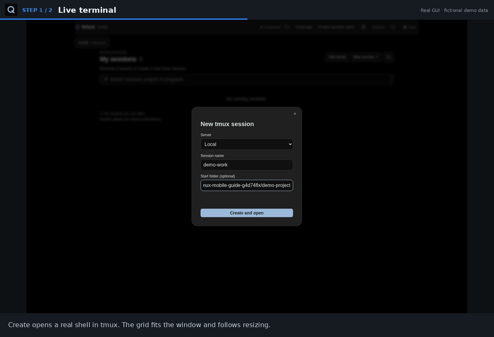


Click **Terminal** to see the live tmux grid; click **Reader** to return. On desktop, the terminal fits the available width and height, including after resizing. Phone mirrors preserve the source pane’s terminal size. The left session list remains available in either view.

Use the fullscreen control to expand the terminal or reader. The bottom composer remains available, with its draft and target pane preserved.

## 6. Compose messages and use the keyboard

1. Select the intended session and pane. Its label appears above the composer.
2. Type in **Message** mode. On desktop, Enter sends and Shift+Enter inserts a newline. On a phone, Enter inserts a newline and the up-arrow button sends.
3. Enter during Korean IME composition does not submit the draft.
4. Drag the composer’s resize handle to change its height, or collapse/expand it with its toggle.

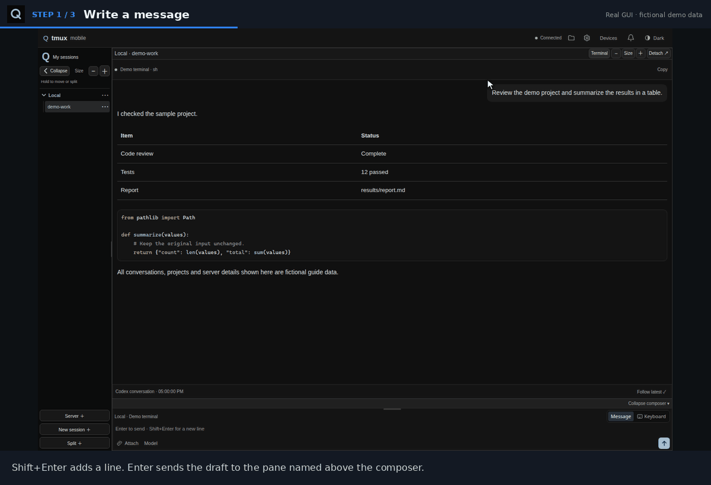


**Keyboard** sends each key immediately; there is no separate send step. Use Ctrl/Shift toggles, arrows, Escape, Tab, Backspace and Enter for terminal applications. Return to Message mode to recover your draft. Verify the target pane before typing.


## 7. Split workspaces side by side or top/bottom

1. Open a session, then click **Split ＋** at the bottom of the sidebar.
2. Choose the session to add in the menu’s selector. You may open another view of the same session or choose a different session.
3. Choose **Left**, **Right**, **Top** or **Bottom** relative to the active workspace.
4. Click a pane’s heading to activate it; its composer sends to that pane.
5. Drag the divider to resize the two workspaces. Further splits can be added when there is enough room.

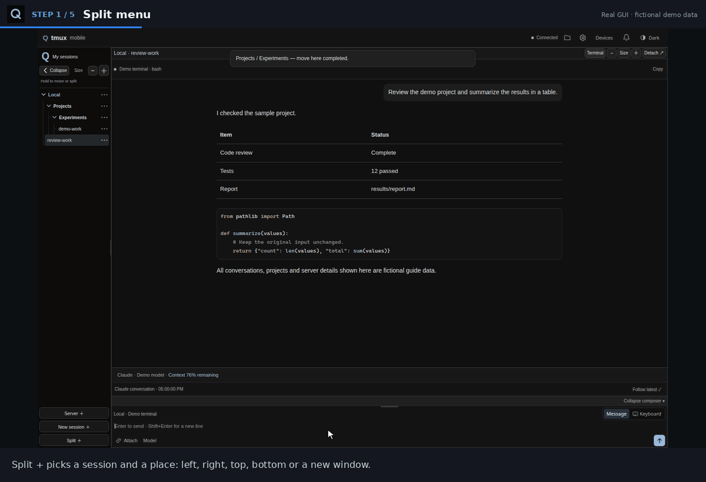


On desktop, dragging a session to a workspace edge also creates a split. Drag a workspace heading to rearrange its group. On a phone, use the explicit Split button or hold before dragging. Top/bottom halves are supported when the available height fits both panels.


If a viewport becomes too small, the app shows the active workspace and restores the split when room returns. Disabled directions mean the resulting panels would be too small. These are **web workspace splits**; they do not issue tmux’s native split-pane command.

Use **×** on a workspace to close that view. This keeps its tmux session running. The last remaining workspace cannot be closed with the split-view × control.

## 8. Detach and return a workspace

1. Click **Detach ↗** in the workspace heading, or select **Open in separate window ↗** from Split ＋.
2. Allow this site’s popups if the browser blocks the new window.
3. Work in the new window with the same session and transferred draft. The source keeps a recovery copy.
4. Click **Return ↙** in the detached window to restore it to the original workspace.

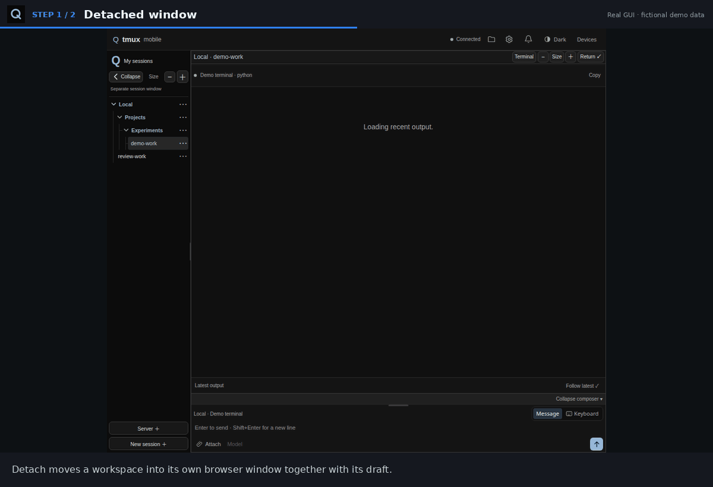


Dragging a workspace heading outside the browser is another desktop shortcut. Switching servers or sessions should still target the chosen pane; window separation does not create a new tmux process.

## 9. Resize the sidebar, panels and text

- Drag the sidebar’s right edge to change its width. Double-click the divider to restore the default width.
- Use **Collapse** to fold the session list, then expand it again when needed.
- Sidebar **− / +** controls change the list size, including its server headings. A workspace’s own **− / Size / +** controls affect that workspace.
- Size controls support 20–500%. Composer sizing is separate from the surrounding workspace where provided.
- Resize split dividers and the composer handle to divide the available space. Narrow screens use the available viewport rather than extending the page horizontally.

## 10. Use commands, skills and models

In Codex, type `/` for commands and `$` for installed skills. Selecting a suggestion inserts it into the draft; it does not automatically send. The actual catalog comes from the selected server and agent installation.


Claude uses `/` for commands and skills. It does not receive Codex’s dollar-sign skill menu.


Click **Model** to choose from the connected CLI’s available models and reasoning settings. The Default/Fast choices here are documentation fixtures. Actual availability depends on the running CLI; opening a dialog is not proof that a model change succeeded.

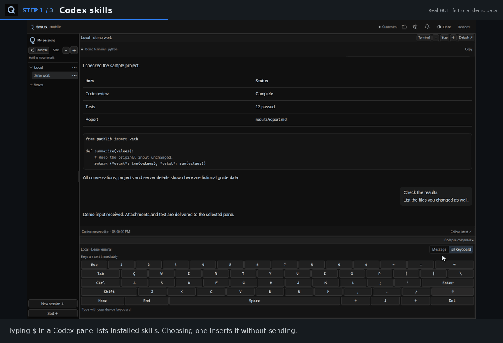


## 11. Browse and preview server files

1. Click the folder icon in the application header. The browser opens on the selected session’s server and working folder.
2. Click an arrow to expand a folder inline. Double-click a folder, or tap it twice on a phone, to enter it.
3. Use Home, Work folder, breadcrumbs or Path to navigate. Refresh reloads the list; Hidden files shows dotfiles.
4. Search file names in the expanded tree. Drag the tree divider or the outer panel edge to adjust width.
5. Select a file to preview it. Code has line numbers and syntax colors; supported images, PDF documents and tables use the same explorer.

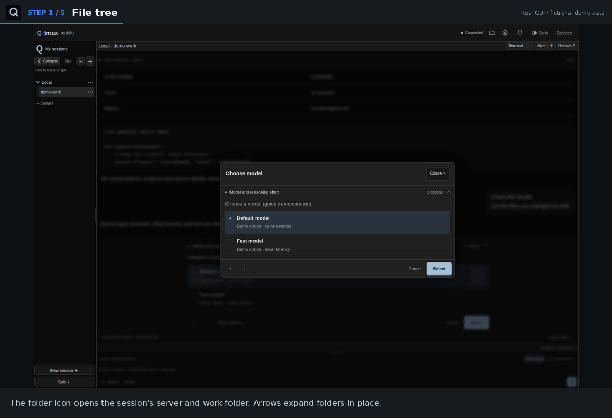


### Office and Hangul documents

Word (`.docx`), Hangul (`.hwp`, `.hwpx`) and Excel files open inside the same panel. Documents appear as a white page with their paragraphs and tables, including merged cells. PowerPoint (`.pptx`) files open as slides at their original aspect ratio, with text, pictures, tables, lines and shapes in place.

The previews are read by the app itself, so the server does not need Office, Hancom or LibreOffice. They are for reading: fonts, charts and SmartArt are simplified, and charts appear as labelled placeholders. Password-protected or distribution-locked HWP files explain why they cannot be shown; download the original to open them in their own program. Slide decks up to 32 MB and other documents up to 12 MB can be previewed.

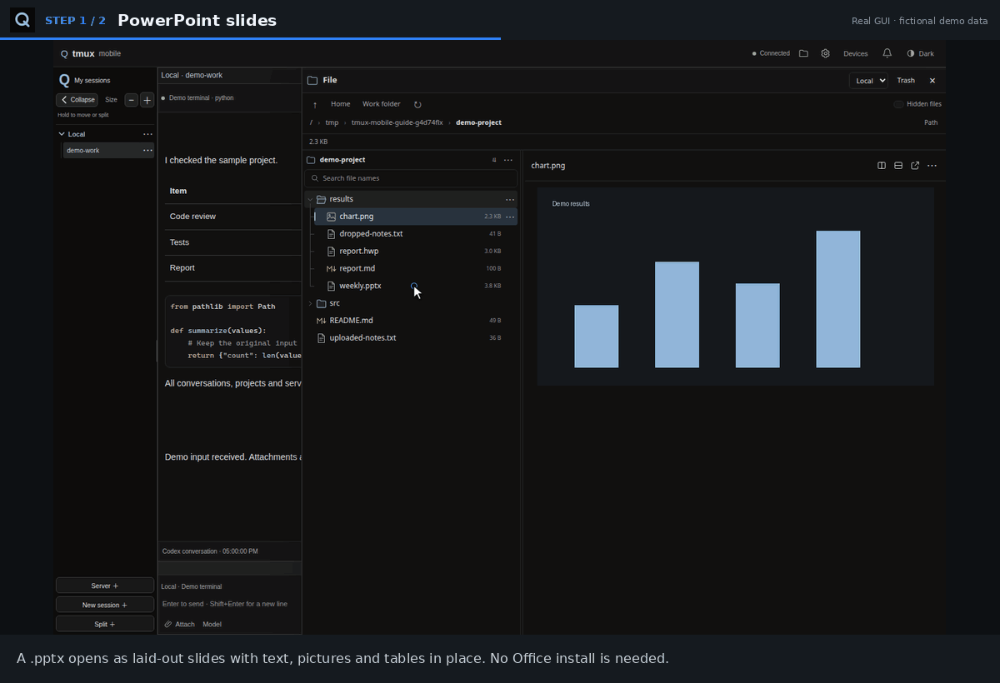


Use a file/folder’s **⋯ → Download** to save it on the current PC, phone or tablet through its browser. Folder downloads use ZIP; the current ZIP limit is 5,000 entries and 32 MB of original contents. Some large/binary previews require downloading the original.

## 12. Edit files and split file windows

1. Open a supported text file and click **Edit** or **⋯ → Edit file**.
2. Change the text. Use **Save**, Ctrl+S or ⌘S. **Close editor** returns to the preview and asks before discarding unsaved changes.
3. If the file changed elsewhere, the app requires conflict review instead of silently overwriting that version.
4. In the opened file’s heading, use **Split side by side**, **Split above and below**, or **Open file in new window**.


File splits are independent of tmux workspace splits. Drag their divider to resize, select a file for the active file pane, and use that pane’s × to close it. Closing the browser/window preserves files saved on disk.

## 13. Upload files into a chosen folder

1. Open the destination server and directory in the file browser.
2. Click the current folder’s or a subfolder’s **⋯ → Attach files**, then select one or more files.
3. On desktop, drop files onto a folder to store them inside it. Dropping on a file uses its parent directory; dropping in empty list space uses the current directory.
4. Check the highlighted destination and wait for completion. Same-name entries are not overwritten.


On a phone, use the same menu and the system file picker. This permanently saves files to the chosen folder; it is separate from a temporary chat attachment.

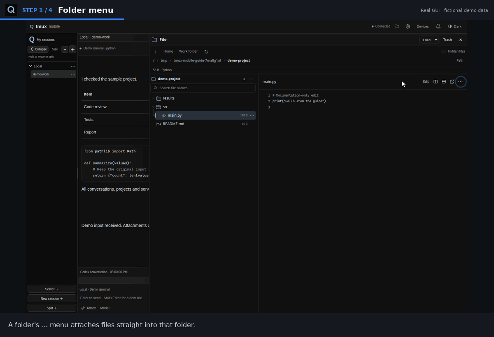


## 14. Trash and restore

Choose **⋯ → Move to Trash** for a file or directory, then open **Trash** in the file browser or Settings. Use **Restore** within seven days to return it to its original location. An existing same-name file is protected. Permanent deletion cannot be undone.


To keep Trash somewhere else, for example on a larger disk, open **Settings**, type an absolute folder in **Trash folder** and press **Save**. **Default path** puts the original back. Items already in the old folder can still be restored until their seven days run out. Session-list folders have nothing to do with this Trash.

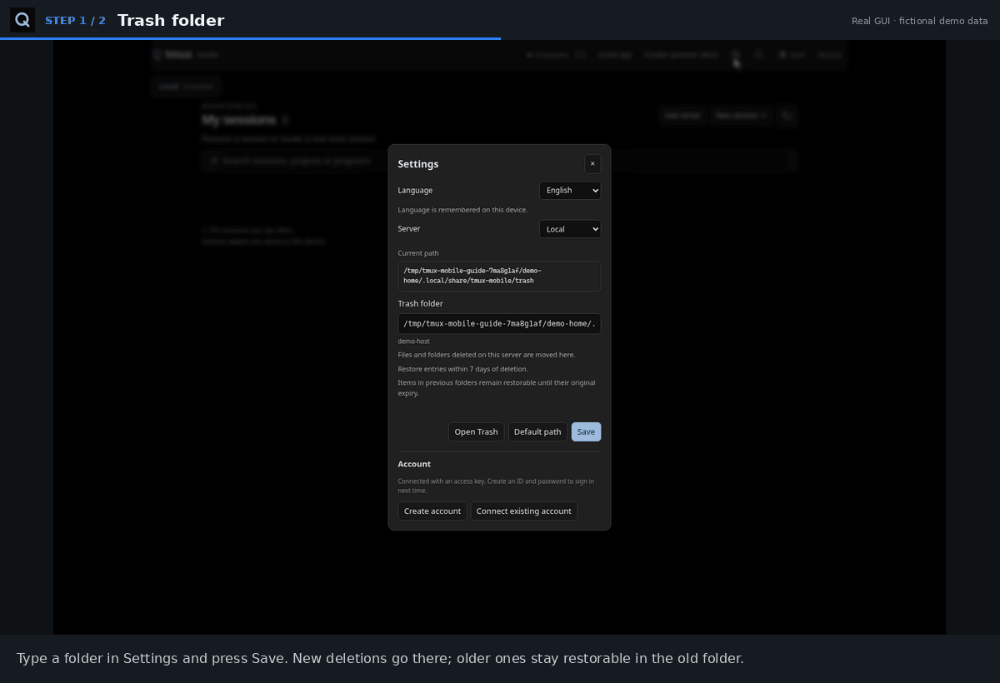

## 15. Attach files to a message and inspect images

Use **Attach** in the composer, drop files onto the conversation area, or paste an image. Select the intended pane first, write the message, then send. The app stores temporary inputs on that pane’s server and supplies their paths to the CLI. Actual remote delivery requires authenticated SSH.


Chat attachments have no file-count limit; each file can be up to 50 MB. They are processing inputs, not permanent storage. Explicitly choose a server folder when asking an agent to retain a result.

Click an attached image or an original-image control to open it inside the app. **Actual size** switches from fit-to-screen to original pixels. Compact **Back** and **Close ×** buttons return to the conversation; browser Back also closes the viewer.

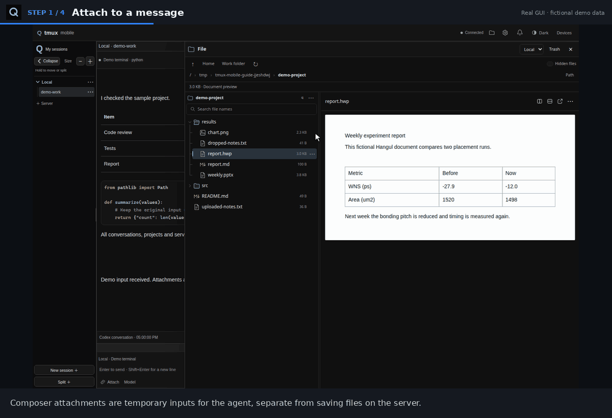


## 16. Notifications

Click the bell to open the inbox. Select a question to jump to its session/pane and mark it read, or mark all items read. Device-notification setup depends on browser permission and platform support. On iPhone, install the web app on the home screen for supported system push notifications.

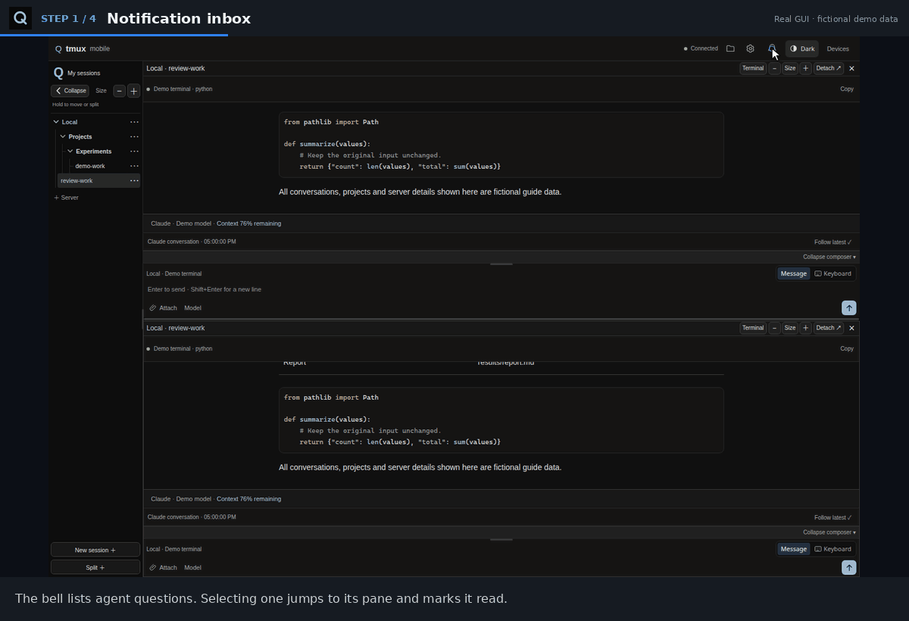

The inbox and temporary banners have **opaque backgrounds** in both themes.


A temporary banner **automatically disappears after eight seconds**. Pressing elsewhere leaves it visible. To dismiss early, use **×** or swipe upward on a phone. The notification remains available from the bell; hiding its banner does not delete the inbox item.


## 17. Language, theme and accounts

Open **Settings** with the gear icon. **Language / 언어** chooses English or Korean for this browser. A new browser defaults to English. An explicit Korean selection survives refreshes and future visits; selecting English changes it back. Content written by users is preserved.


Use the theme control in the header for Light/Dark. Theme selection applies across embedded workspaces.

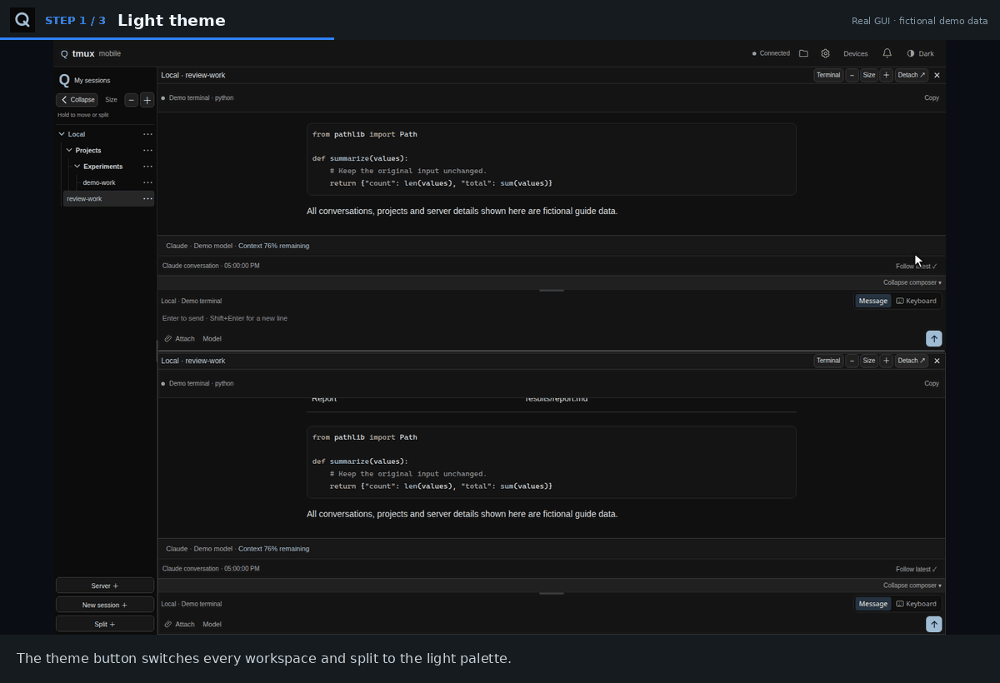

After authenticating with the access key, choose **Settings → Create account**. Sign-up is not offered before that initial key authentication. Passwords require at least ten characters with an English letter, digit and punctuation. Keep the recovery code privately; it is not captured here.

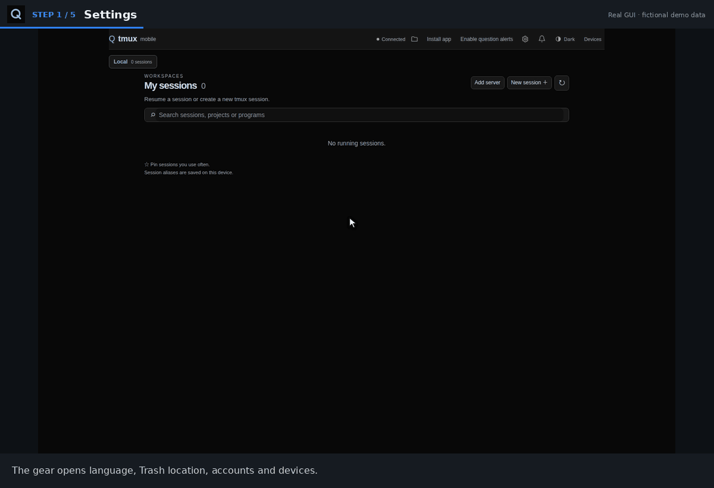


Account settings support ID/password changes, recovery-code replacement and account deletion. **Manage devices** lets you select saved connections or disconnect all devices. Remembered authentication is browser-specific; new devices must sign in.


## 18. Connect another server

1. Click **Server ＋** at the bottom of the sidebar, **Add server** in the manager, or **＋ Add server** in the New session server list.
2. Enter a name, SSH address, account, port and platform. Use your own host; `192.0.2.10` below is a reserved documentation address.
3. Ensure the remote host has SSH, Python 3 and tmux. Windows also needs a default WSL distribution; Mac needs Remote Login enabled.
4. Review the host key, then enter the actual server password directly in the authenticated form.
5. The app registers a dedicated SSH key while preserving existing authorized keys, verifies key login, and then loads that server’s sessions.
6. To rename a server, choose its **⋯ → Rename** and edit the name in the list; Enter saves and Escape cancels. **⋯ → Manage server** still edits the address, account and port.


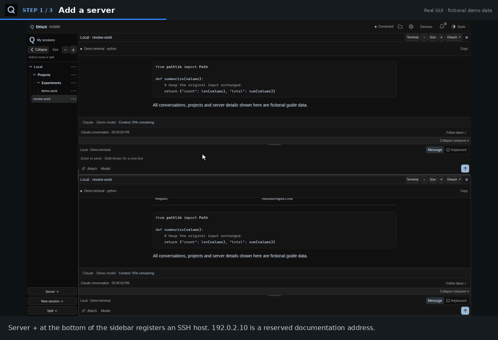

Passwords are not saved. A reachable port or an open setup form is not an authenticated connection. A failed server does not discard other servers or drafts. No real remote login was attempted for these captures.


## Reproduce the walkthrough GIFs

```bash
npm ci
npx playwright install chromium
.venv/bin/python -u scripts/capture_guide.py
```

This creates a disposable local app, account DB, files and isolated tmux server. It verifies default English, remembered Korean, outside-menu dismissal across frames, eight-second banners, upward swipe, compact image controls and actual terminal resizing. Chromium's screencast saves a lossless frame whenever the page changes; each scene's clip runs from the start of its action to its result. The builder resamples clips at a steady frame rate, fast-forwards long waits, zooms into dialogs and cross-fades between scenes. Scene titles and captions live in `scripts/guide-scenes.json`.

It writes the short tour, the complete recording and the per-section GIFs to `demos/`. Raw frames and recovery-code displays are temporary; recordings hide recovery codes and never show password fields. The guide removes its temporary processes, frames and data after encoding. Phone captures use browser emulation rather than a physical iOS keyboard.
